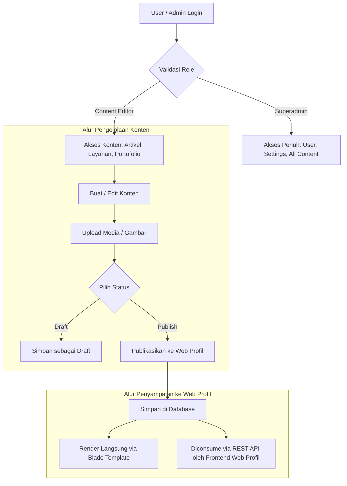

# Implementation Plan - Admin Content Management System (CMS) Web Profil

Dokumen ini berisi rancangan **Alur Kerja (Workflow)**, **Spesifikasi Fitur**, dan **Saran Arsitektur Teknologi** untuk proyek Admin CMS Web Profil sebelum tahap pengembangan dimulai.

---

## 1. Alur Kerja Utama (Workflow)

System workflow dirancang agar intuitif, aman, dan mempermudah pengelolaan konten web profil secara efisien.

### Detail Alur Kerja Operasional:
1. **Autentikasi & Otorisasi**: User melakukan login. Sistem memeriksa hak akses (*Role-Based Access Control / RBAC*).
2. **Manajemen Konten (Draft to Publish)**:
   - Pengelola membuat atau menyunting konten (berita, portofolio, layanan).
   - Pengelola mengunggah media (otomatis dikompresi dan di-resize).
   - Konten dapat disimpan sebagai **Draft** (tidak tampil publik) atau langsung **Published**.
3. **Penyampaian Konten (Content Delivery)**:
   - Konten terupdate secara real-time pada tampilan utama Web Profil (baik secara monolithic via Blade maupun via Headless REST API).
4. **Manajemen Inbox & Leads**:
   - Pengunjung web profil mengisi form kontak / pesan.
   - Admin CMS menerima notifikasi / melihat daftar pesan masuk pada Dashboard Admin dan dapat mengekspor data tersebut.

---

## 2. Matriks Fitur & Modul CMS

Berikut adalah rincian modul dan fitur yang direkomendasikan untuk Admin Web Profil:

| Modul CMS | Fitur Utama | Manfaat & Deskripsi |
| :--- | :--- | :--- |
| **1. Dashboard Analytics** | • Widget Statistik (Jumlah Berita, Pesan Baru, Layanan, Visitor) • Aktivitas Terbaru (Recent Logs) • Pintasan Cepat (Quick Shortcut) | Memberikan gambaran singkat mengenai performa web profil dan konten terbaru. |
| **2. Pengaturan Profil Perusahaan** | • Identitas Perusahaan (Nama, Logo, Favicon, Tagline) • Visi, Misi & Nilai Perusahaan • Sejarah & Milestone • Informasi Kontak (Alamat, Map Google Embed, Email, Telp, WA) | Memudahkan pengubahan data identitas utama tanpa perlu ubah kodingan. |
| **3. Hero & Banner Slider** | • Management Banner Home (Gambar/Video, Judul, Subtitle) • Link Call to Action (CTA) & Tombol • Urutan Tampilan (Drag & Drop ordering) | Mengatur promosi utama di halaman depan web profil. |
| **4. Layanan / Produk (Services)** | • CRUD Layanan / Produk • Kategori Layanan & Ikon/Ilustrasi • Detail Deskripsi (WYSIWYG Editor) • Status Aktif / Non-aktif | Menampilkan katalog jasa/produk yang ditawarkan perusahaan. |
| **5. Portofolio & Proyek** | • Galeri Proyek (Multi-image Upload) • Filter Berdasarkan Kategori / Industri • Detail Client, Tahun Selesai, & Testimoni Proyek | Memamerkan hasil kerja / karya terbaik perusahaan. |
| **6. Berita / Artikel / Blog** | • Rich-Text Editor (Gambar, Video Embed, Formatting) • Kategori & Tags Artikel • Featured Image & Author • Meta SEO (Title, Description, Keyword, OG-Image) | Untuk konten inbound marketing & meningkatkan peringkat SEO Google. |
| **7. Tim & Karir (Opsional)** | • Profil Manajemen / Anggota Tim (Foto, Jabatan, Sosmed) • Lowongan Pekerjaan (Job Vacancy) • Inbox Lamaran Masuk (PDF CV) | Menampilkan kredibilitas tim dan membuka rekrutmen. |
| **8. Testimoni & Client Logo** | • Management Client/Partner Logos • Ulasan / Testimoni Pelanggan (Rating, Nama, Jabatan, Foto) | Meningkatkan *social proof* dan kepercayaan calon klien. |
| **9. Inbox & Pesan Masuk** | • Daftar Pesan dari Form Kontak Web • Filter Status (Unread, Read, Replied) • Export Data Pesan ke Excel/CSV | Menampung calon klien (*leads generation*). |
| **10. Pengaturan SEO & Sosmed** | • Global Meta SEO Tags • Social Media Links (Instagram, LinkedIn, Facebook, YouTube) • Integration Scripts (Google Analytics ID, Facebook Pixel, Tawk.to/WA Widget) | Mengoptimalkan keterbacaan di mesin pencari dan integrasi analitik. |
| **11. Manajemen User & Role (RBAC)** | • User Management (Super Admin, Editor, Viewer) • Manajemen Permission & Audit Log | Menjaga keamanan akses ke dalam CMS. |
| **12. Media Library** | • Centralized File & Image Manager • Automatic Image Compression (WebP Conversion) • Copy URL File / Insert to Content | Memudahkan penggunaan ulang aset gambar/dokumen. |

---

## 3. Saran Arsitektur & Teknologi

Proyek ini saat ini berbasis **Laravel** (PHP 8.3 + Tailwind CSS v4). Terdapat 3 opsi pendekatan pengembangan:

> [!TIP]
> **Rekomendasi Utama: Opsi 1 (Laravel + Filament v3 Admin Panel)**
> Filament v3 adalah admin panel resmi paling populer untuk Laravel. Filament menyediakan UI yang sangat modern, bersih, responsive out-of-the-box, lengkap dengan Form Builder, Table Builder, Media Manager, Rich Text Editor, dan Role Management yang mempercepat waktu development hingga 70%.

### Ringkasan Opsi Pendekatan:

1. **Opsi 1: Laravel + Filament Admin v3 (Rekomendasi Terbaik)**
   - **Tampilan Admin**: Filament Admin Panel (UI Super Sleek, Modern, Dark/Light Mode).
   - **Tampilan Web Profil**: Laravel Blade + Tailwind CSS v4 (atau Inertia/Vue).
   - **Kelebihan**: Sangat cepat dikembangkan, fitur lengkap, aman, standar industri Laravel.

2. **Opsi 2: Custom Admin Dashboard (Laravel Blade + Tailwind CSS v4)**
   - **Tampilan Admin**: Custom Blade Templates dengan Tailwind CSS v4.
   - **Kelebihan**: Kontrol 100% pada struktur UI admin tanpa ketergantungan paket admin pihak ketiga.
   - **Kekurangan**: Membutuhkan waktu pengerjaan lebih lama untuk fitur dasar seperti file manager, WYSIWYG, dan datatables.

3. **Opsi 3: Headless CMS (Laravel REST API + Decoupled Frontend)**
   - **Tampilan Admin**: Admin Panel (Filament / Custom Blade).
   - **Penyampaian Konten**: RESTful API / Sanctum endpoints.
   - **Tampilan Web Profil**: Next.js / Nuxt.js / HTML Static.
   - **Kelebihan**: Satu Admin CMS dapat melayani multiple web profil frontend secara fleksibel.

---

## 4. User Review Required & Open Questions

Mohon konfirmasi beberapa hal berikut sebelum pengembangan dimulai:

> [!IMPORTANT]
> 1. **Pendekatan Tampilan Admin**: Apakah Anda menyetujui rekomendasi **Opsi 1 (Laravel + Filament v3)** untuk Admin CMS, atau lebih memilih **Opsi 2 (Custom Blade)**?
> 2. **Target Frontend Web Profil**: Apakah web profil publik akan langsung dirender menggunakan **Laravel Blade + Tailwind v4** di dalam repository ini, atau disajikan via **API (Headless)** ke frontend terpisah?
> 3. **Prioritas Modul Utama**: Dari modul 1–12 di atas, apakah ada modul tertentu yang ingin diprioritaskan terlebih dahulu pada MVP (Minimum Viable Product)?

---

## 5. Rencana Tahapan Eksekusi (Verification & Roadmap Plan)

Setelah Anda memberikan tanggapan:
- **Phase 1**: Setup Database Schema (Migrations, Seeders, Models untuk User, Profile, Services, Projects, Articles, Settings).
- **Phase 2**: Implementasi Admin CMS (Authentication, RBAC, Modul-Modul Content Management, Media Uploader).
- **Phase 3**: Integration / Frontend Web Profil (Routing, Blade views / API endpoints).
- **Phase 4**: Testing, Verification (Feature tests, validation & responsiveness check).
